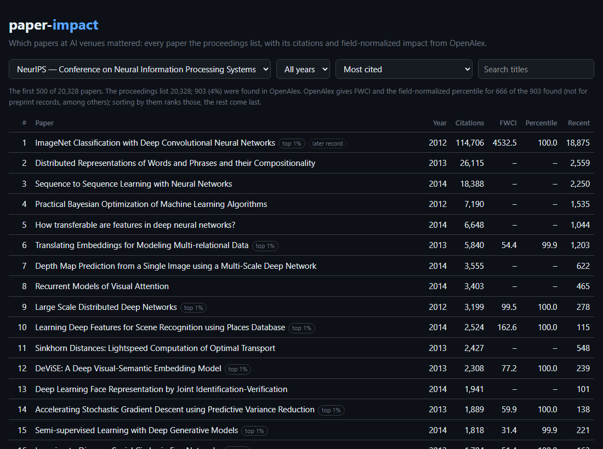

<div align="center">

# paper-impact

**AI 会议里哪些论文真正有影响：NeurIPS、ICML、ICLR、CVPR 与 ACL 历年发表的每一篇论文，连同它的被引数和领域归一化影响力。** 论文清单来自各会议自己的论文集，
数字来自 [OpenAlex](https://openalex.org)（开放数据，CC0）。公开 JSON 加静态网站，每天重建。

<a href="https://github.com/zch6a/paper-impact/actions/workflows/ci.yml"></a>


<a href="LICENSE"></a>

[English](README.md) · **简体中文**

</div>

---

<p align="center"><a href="https://zch6a.github.io/paper-impact/"></a></p>
<p align="center"><b><a href="https://zch6a.github.io/paper-impact/">zch6a.github.io/paper-impact</a></b>：每日构建匹配到更多论文，网站随之填满（见<a href="#局限">局限</a>）。</p>

会议论文的被引数很分散：同一篇论文的预印本和论文集版本是两条记录；会议的归属登记得不一致（OpenAlex 里名为
“International Conference on Learning Representations”的 source 总共只有 602 篇）；原始被引数又偏向老论文和大领域。
paper-impact 从各会议论文集列出的论文出发，在 OpenAlex 里逐篇找到它们，把 OpenAlex 的领域归一化指标和原始被引数放在一起，并说明找到了多少。

ICML 2017 的实际构建结果（论文集共 434 篇）：

| | |
|---|---|
| 在 OpenAlex 里找到 | 418 篇（96%），共 39 次请求（页面 1 次、精确标题搜索 22 次、对未命中的宽松重试 16 次） |
| 被引最多 | Model-Agnostic Meta-Learning（9,057）、Wasserstein GAN（6,442）、Neural Message Passing for Quantum Chemistry（5,745） |
| 有 FWCI 和百分位的 | 418 篇中的 135 篇（OpenAlex 只给部分记录计算，预印本记录没有） |

## 网站

选会议和年份（或全部年份），按被引数、领域归一化百分位、FWCI 或近两年被引排序，搜索标题。每个会议年份都链接到它的论文集，并说明找到了多少篇；
没找到的论文照样列出，只是没有数字。数据公开：`data/index.json` 和每个会议年份一个文件。

## 自己构建

```bash
uvx --from git+https://github.com/zch6a/paper-impact paper-impact build venues.json -o site/ --years 2015-2024
```

[venues.json](venues.json) 按论文集页面列出 NeurIPS 2012–2024、ICML 2013–2025（PMLR）、ICLR 2021–2025（会议网站的论文页）、CVPR 2013–2025（CVF open access）和 ACL 2013–2025（长文；2020 年为主卷，含长文与短文），共 69889 篇；每个页面都写明它必须包含的文字（会议名、年份），
卷号写错时会直接报错，不会悄悄混进另一个会议。

- **匹配**：标题在 OpenAlex 里每次约 20 个一起搜索，只接受规范化后完全相同、年份相差不超过一年的记录；五个词以上的标题也接受年份更晚的记录
  （OpenAlex 有时按后来的重印本给主记录定年份：NeurIPS 2012 的 AlexNet 是一条 2017 年的记录，11 万多次被引都在它上面），这种在数据里标为
  `later`，页面上显示 “later record”。没命中的再宽松地试一次（85% 的词相同、长度相近，仍限一年内），标为 `close`（页面上 “near title”）。
  预印本和论文集版本两条记录时，显示被引更多的那条，另一条记在 `also` 里（不相加：OpenAlex 是分开计数的）。页面上每个被引数都链接到它来自的
  OpenAlex 记录。
- **费用**：每次搜索花 OpenAlex 额度 0.001 美元：一个 1000 篇的会议年份约 50 次搜索，加上每篇未命中的宽松重试一次（共 0.05 到 0.15 美元）。搜过但没找到的论文 30 天后才会再搜。不设 `OPENALEX_API_KEY` 时每天 0.10 美元额度，
  同一 IP 下所有人共享；免费 key 每天 1 美元。重建时复用 `site/` 里已有的数据：只搜索还没找到的论文，其余按 ID 刷新（每次请求 100 篇，0.0001 美元）；OpenAlex 不再返回其 ID 的论文会重新搜索；匹配规则改变后，所有精确匹配也会重新搜索（新搜索有结果之前保留原来的记录）。key 被拒绝时构建停止，但仍会写出已匹配的数据，并以退出码 2 结束。某个会议年份的页面出错时（页面变了、网站宕机）保留它上次的数据并报告，其余照常构建。同一会议年份里标题相同的两篇论文都会列出，但都不匹配（一条记录分不清是哪一篇）；很短且同名作品很多的标题（如 “Introduction”）也一样。
- **每日构建**（[site.yml](.github/workflows/site.yml)）：构建任务用只读权限运行，数据存在 Actions 缓存里；部署任务只负责发布到 Pages。
  每次运行先对所有会议年份分批做精确标题搜索，剩下的额度再做宽松重试。不带 key 时用的是 runner 共享的 0.10 美元额度，最初几次运行每次只匹配约 250 到 650 篇，网站要几个月才能填满；在仓库里加一个 `OPENALEX_API_KEY` secret（每天 1000 次搜索、约 2 万个标题）最多几周。

## 今天的 arXiv，有信号的排前面：`paper-impact today`

每日推荐工具按论文和你研究方向的接近程度排序。`paper-impact today cs.CL` 按论文本身给出的信号给某个分类的最新投稿排序，并说明是哪种信号：**已接收**（arXiv 的备注写明被某个会议或期刊接收：“Accepted at NeurIPS 2026”、“Published in ACM Multimedia 2026”、“WSDM camera ready”；研讨会分量低一些）、**有代码**（GitHub、GitLab、Hugging Face 或项目主页的链接，或 “code is available”），以及加 `--citations` 时已有多少引用（来自 OpenAlex，按 arXiv 的 DOI 查；适合 `--days 7` 以上）。没有信号的论文并不是更差，只是还没有给出这些信息。

```console
$ paper-impact today cs.CL --days 2 --top 3
cs.CL: 60 papers, 22 with signs (accepted 7, code 17)

2026-11-12  2611.16694   When Expert Disagreement Hurts: Prestige and Selectivity in LLM Decision Revision
            Yupeng Tang, Mingfeng Lin  ·  accepted: NeurIPS; code
            https://github.com/yupengtang/when-expert-disagreement-hurts
2026-11-12  2611.17287   Negative-Only Policy Optimization for One-Sided Verifiable Rewards
            Jiacheng Xu, Shuo He, Fuxiang Zhang et al.  ·  accepted: NeurIPS
2026-11-12  2611.17107   Disentangling Spurious Correlations: How IRM Handles Diverse Shortcuts in Text Classification
            Paul Grunenwald, Benoît Crabbé, Guillaume Wisniewski et al.  ·  accepted: EMNLP
```

以上是第一次运行的输出（截至 2026-11-14 的两天）。它给出的每个信号都是对的（7 篇已接收、17 个代码链接）；漏掉了 4 篇在列表之外的会议或期刊的接收（“Accepted to IEEE TASLP”、“Published at ... INLG”、“Accepted for publication in PMLR”、“WSDM camera ready”），所以现在任何接收的说法都算，并原样显示会议名。同两天的 cs.CV 共 86 篇：18 篇已接收、29 个代码信号，都是真的（其中一篇摘要里的链接是占位的 `https://github.com.`）。备注里只写 “NeurIPS 2026” 的不算：它也可能只是投稿。`--format markdown` 用于 issue 或网页，`--format json` 输出全部内容；每 100 篇向 arXiv 请求一次，间隔三秒。

## 这些数字是什么

| | |
|---|---|
| 被引 | OpenAlex 对匹配到的那条记录的计数 |
| FWCI | 领域加权引用影响力：1.0 是同领域、同类型、同年份作品的世界平均 |
| 百分位 | OpenAlex 的 `citation_normalized_percentile`，以及前 1% / 前 10% 标记 |
| 近两年 | 最近两个完整年份的被引数，取自 OpenAlex 的逐年计数 |

## 局限

- 只有 OpenAlex 里有的：ICML 2017 约 4% 的论文按标题找不到；被引分散在多条记录上的论文只显示其中一条的计数。
- 会议论文里只有少数有 FWCI 和百分位（预印本记录常常没有）；按它们排序时只排有数字的，其余放在后面，页面上会写明有多少篇。
- 会议论文集上线之后才收录：NeurIPS 2025 目前只上线了 Creative AI 分区，暂不收录。
- 仓库 60 天没有任何活动时，GitHub 会暂停定时工作流；每日构建就要等下一次提交或手动运行（缓存的数据在 7 天不用后才会被清除）。

## 同一套工具

[paper-proof](https://github.com/zch6a/paper-proof) 检查论文的参考文献与数字；[submit-check](https://github.com/zch6a/submit-check) 按会议规则检查论文；
[arxiv-diff](https://github.com/zch6a/arxiv-diff) 显示版本之间改了什么；[exp-tables](https://github.com/zch6a/exp-tables) 把实验结果变成只在有依据时才加粗的表格；
[scholar-cards](https://github.com/zch6a/scholar-cards) 把学者的数字放到个人主页上。

## 属于 research-kit

这是 13 个开源科研工具之一，覆盖从读论文到论文发表之后。全部工具按科研流程的介绍，以及安装它们技能的 Claude Code 插件市场，见 [research-kit](https://github.com/zch6a/research-kit) · [网站](https://zch6a.github.io/research-kit/)。

## 许可证

代码为 MIT。数据来自 OpenAlex（CC0）和各会议论文集的列表（标题与链接）。
